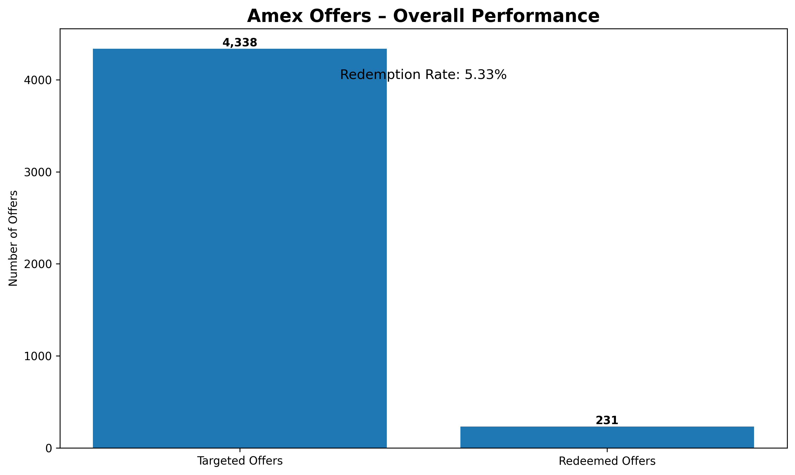
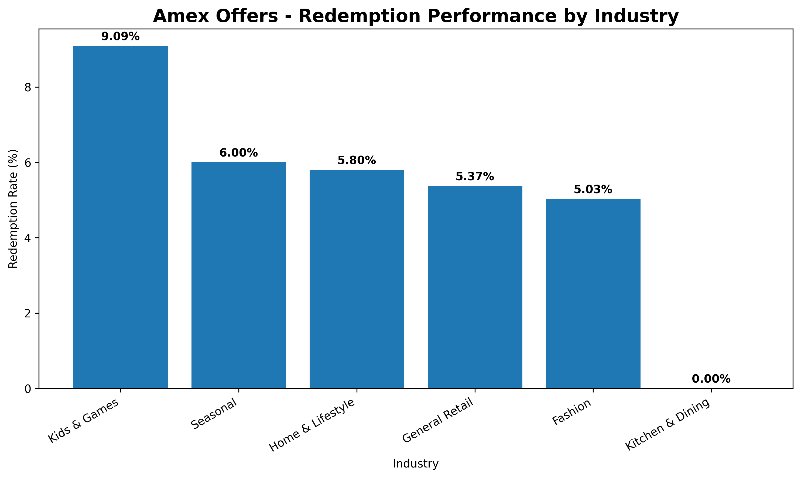
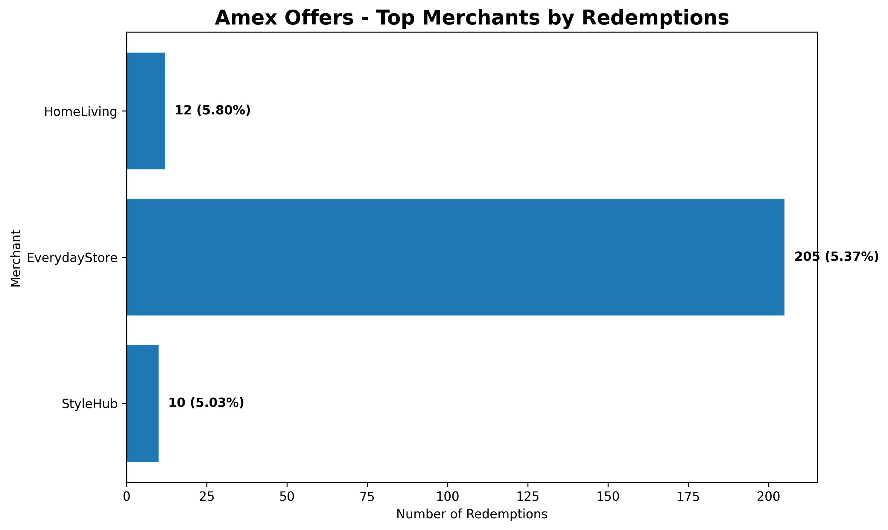
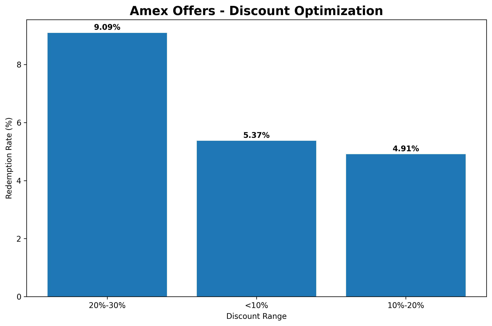
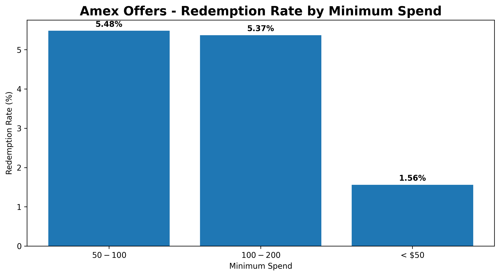

# Amex Offers Analytics & Redemption Optimization


## 📌 Project Overview

An end-to-end analytics project focused on **customer offer targeting, offer redemption, merchant performance, and offer optimization**.

The project simulates an Amex Offers-style analytics use case where customer, merchant, transaction, and offer data are analyzed to identify actionable opportunities for improving **offer adoption and merchant engagement**.

The analysis combines **Python, PostgreSQL, and SQL** to move from raw data processing to business insights and recommendations.

---

# 🎯 Business Problem

Offer platforms need to answer several important business questions:

- Which offers are most likely to be redeemed?
- Which customer segments respond better to offers?
- Which merchants and industries have stronger engagement?
- How does discount size affect redemption?
- How does minimum-spend requirement affect redemption?
- Which customers represent potential targeting opportunities?
- How can offer strategies be optimized using customer behavior?

This project addresses these questions through exploratory analysis, SQL-based business analytics, customer segmentation, and visualization.

---

# 🎯 Project Objectives

The major objectives of the project are:

1. Analyze overall offer redemption performance.
2. Identify high-performing offer types.
3. Analyze merchant and industry-level performance.
4. Segment customers based on spending behavior.
5. Evaluate discount-level effectiveness.
6. Analyze the impact of minimum-spend requirements.
7. Identify high-value targeting opportunities.
8. Convert analytical findings into actionable business recommendations.

---

# 🛠️ Technology Stack

### Programming & Analytics

- Python
- Pandas
- NumPy

### Database & SQL

- PostgreSQL
- SQL
- pgAdmin

### Visualization

- Matplotlib

### Development Tools

- Jupyter Notebook
- VS Code
- Git
- GitHub

---

# 📂 Project Structure

```text
Offers-analytics/
│
├── data/
│   ├── Online Retail.xlsx
│   └── README.md
│
├── images/
│   ├── overall_offer_performance.png
│   ├── redemption_rate_by_offer_type.png
│   ├── redemption_performance_by_industry.png
│   ├── top_merchants.png
│   ├── customer_segmentation.png
│   ├── discount_optimization.png
│   └── minimum_spend_optimization.png
│
├── notebooks/
│   └── amex_analysis.ipynb
│
├── outputs/
│   ├── customers.csv
│   ├── merchant_performance.csv
│   ├── merchants.csv
│   ├── offer_performance.csv
│   ├── offers.csv
│   ├── products.csv
│   ├── redemptions.csv
│   ├── rfm.csv
│   ├── segment_performance.csv
│   ├── targeting.csv
│   └── transactions.csv
│
├── sql/
│   └── amex_analysis.sql
│
└── README.md
```

---

# 🔄 Project Workflow

```text
Raw Dataset
     │
     ▼
Data Cleaning & Transformation
     │
     ▼
Python / Pandas Analysis
     │
     ▼
Processed CSV Outputs
     │
     ▼
PostgreSQL Database
     │
     ▼
SQL Business Analysis
     │
     ▼
Customer / Offer / Merchant Insights
     │
     ▼
Data Visualization
     │
     ▼
Business Recommendations
```

---

# 📊 Dataset

The project uses an e-commerce/retail dataset containing customer transaction information that is transformed into an **Amex Offers-style analytical dataset**.

The processed analytical data includes:

- Customers
- Transactions
- Products
- Merchants
- Offers
- Customer targeting
- Offer redemptions
- Customer segments / RFM metrics

The raw source dataset is included in the `data/` directory where applicable.

---

# 🧹 Data Preparation

Python and Pandas were used to prepare the analytical datasets.

The data preparation workflow included:

- Loading raw transaction data
- Data type conversion
- Handling missing values
- Creating customer-level metrics
- Creating merchant-level metrics
- Creating offer-level metrics
- Generating customer segments
- Creating targeting datasets
- Creating redemption datasets
- Exporting processed datasets as CSV files

---

# 🗄️ PostgreSQL & SQL Analysis

Processed datasets were loaded into PostgreSQL for business analysis.

The SQL analysis includes:

### 1. Overall Offer Performance

Measured:

- Total targeted offers
- Total redemptions
- Redemption rate
- Average predicted redemption probability
- Average discount
- Average minimum spend

### 2. Offer Type Analysis

Compared redemption performance across different offer types.

### 3. Industry Analysis

Analyzed redemption rates across industries to identify stronger-performing categories.

### 4. Merchant Analysis

Ranked merchants based on:

- Targeting volume
- Redemption volume
- Redemption rate
- Average discount

### 5. Customer Segmentation

Customers were categorized into:

- Low Spend
- Medium Spend
- High Spend
- Very High Spend

### 6. Discount Optimization

Analyzed redemption performance across discount ranges:

- <10%
- 10%-20%
- 20%-30%
- 30%+

### 7. Minimum Spend Optimization

Analyzed redemption performance across minimum-spend thresholds:

- < $50
- $50-$100
- $100-$200
- $200+

---

# 📈 Key Business Metrics

The analysis identified:

| Metric | Result |
|---|---:|
| Total Targeted Offers | 4,338 |
| Total Redemptions | 231 |
| Overall Redemption Rate | 5.33% |
| Avg. Predicted Redemption Probability | 5.17% |
| Avg. Discount | 5.92% |
| Avg. Minimum Spend | $95.14 |

---

# 🔍 Key Findings

## 1. Overall Redemption

The dataset contained **4,338 targeted offers**, of which **231 were redeemed**, resulting in an overall redemption rate of **5.33%**.

The average predicted redemption probability was approximately **5.17%**, which is close to the observed redemption rate.

---

## 2. Industry Performance

Redemption performance varied across industries.

The analysis showed stronger engagement in some categories, providing opportunities to prioritize high-performing industries when designing future campaigns.

---

## 3. Customer Segmentation

Higher-spending customer segments showed stronger redemption performance compared with the lowest-spend segment.

This suggests that customer spending behavior can be useful when developing personalized targeting strategies.

---

## 4. Discount Optimization

The **20%-30% discount range** achieved the highest observed redemption rate among the analyzed discount buckets.

However, this analysis is observational and does not establish that higher discounts directly cause higher redemption.

---

## 5. Minimum Spend Optimization

Offers with a **$50-$100 minimum spend** achieved a higher redemption rate than offers with a minimum spend below $50.

This indicates that minimum-spend thresholds can be an important factor when optimizing offer design.

---

## 6. Merchant Performance

Merchant-level analysis identified differences in redemption performance across merchants.

This can help identify merchants where stronger customer engagement may support future offer expansion.

---

# 📊 Visualizations

## Overall Offer Performance



---

## Redemption Rate by Offer Type


---

## Redemption Performance by Industry



---

## Top Merchants



---

## Customer Segmentation


---

## Discount Optimization



---

## Minimum Spend Optimization



---

# 💡 Business Recommendations

Based on the analysis, the following strategies can be considered:

### 1. Personalize Offer Targeting

Use customer spending behavior and engagement history to prioritize customers who are more likely to redeem.

### 2. Prioritize High-Performing Segments

Higher-value customer segments can be considered for personalized campaigns where the expected incremental value justifies the incentive.

### 3. Optimize Minimum-Spend Thresholds

Evaluate thresholds around the **$50-$100 range** while balancing redemption likelihood against transaction economics.

### 4. Optimize Discounts

Use discount levels strategically rather than assuming that larger discounts always produce better outcomes.

### 5. Strengthen Merchant Partnerships

Identify merchants and industries with strong engagement and evaluate opportunities for additional offer campaigns.

### 6. Move Toward Predictive Targeting

The next step would be to build a predictive model that estimates individual customer redemption probability and optimizes targeting based on expected value.

---

# ⚠️ Analytical Limitations

This project is an observational analytics project and therefore has several limitations:

- Redemption correlation does not imply causation.
- Higher discounts may be associated with other campaign characteristics.
- Customer targeting may already be influenced by previous behavior.
- No randomized control group is available in this project.
- Incremental lift cannot be directly measured from observational data alone.


# 📁 Important Files

### Python Analysis

notebooks/amex_analysis.ipynb

Contains:

- Data preparation
- Exploratory analysis
- Customer analysis
- Offer analysis
- Visualizations

### SQL Analysis

sql/amex_analysis.sql

Contains PostgreSQL queries for:

- Offer performance
- Merchant analysis
- Industry analysis
- Customer segmentation
- Discount optimization
- Minimum-spend optimization

---

# 🎓 Skills Demonstrated

This project demonstrates practical experience with:

- Python
- Pandas
- NumPy
- SQL
- PostgreSQL
- Data Cleaning
- Exploratory Data Analysis
- Customer Segmentation
- Merchant Analytics
- Offer Analytics
- KPI Analysis
- Business Intelligence
- Data Visualization
- Business Problem Solving
- Analytical Storytelling

---

# 👨‍💻 Author

## Ashish Rawat

Aspiring Data Analyst with experience in:

- Data Analytics
- SQL
- Python
- PostgreSQL
- Power BI
- Excel
- PySpark
- Hive

---

# 📌 Disclaimer

This is a **portfolio analytics project inspired by an Amex Offers-style business problem**.

It does not use proprietary American Express data, systems, or confidential information.

The purpose of the project is to demonstrate analytical, SQL, Python, and business problem-solving capabilities.